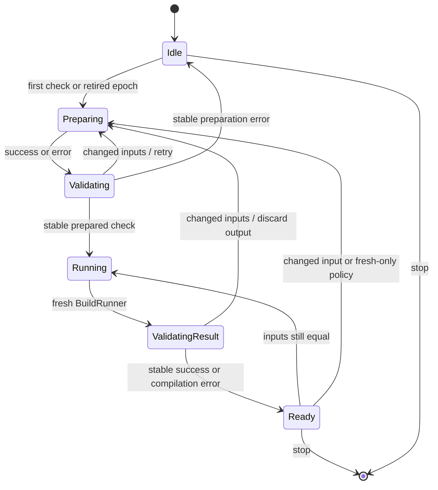

# Cargo sessions: design and implementation

## Status and objective

This document records the original single-check foundation. The current
[workspace daemon](CARGO_SESSION_WORKSPACE.md) extends it with independently
retained command plans, registry and Git inputs, Clippy, tests, and benchmarks.
Its protocol and command contract supersede the corresponding sections below.

This implements an experimental, explicit Unix `cargo session` server inside
Cargo. Its purpose is to avoid repeating workspace preparation during an edit /
check loop while preserving Cargo's ordinary compilation and freshness logic.
The implementation is a foundation for incremental preparation, with one coarse
cached computation today: `PreparedCheck`.

The design follows [Buck2's DICE
model](https://buck2.build/docs/insights_and_knowledge/modern_dice/) and
[Skyframe's dependency rule](https://bazel.build/reference/skyframe): a cached
computation is valid only while its observed dependencies have the same values.
It does not embed DICE, implement a new resolver, or cache rustc actions itself.
[Buck2's daemon](https://buck2.build/docs/concepts/daemon/) also motivates
keeping persistent analysis separate from command-local execution and resources.

## User contract

```sh
cargo build --release --bin cargo
export CARGO_SESSION_BIN=/absolute/path/to/this/checkout/target/release/cargo
cd /path/to/project
export RUSTC="$(rustup which rustc)"
"$CARGO_SESSION_BIN" session serve -p my-package --lib
```

Once the foreground server prints `Listening`, use another shell with the same
working directory and environment (including the same `RUSTC`):

```sh
"$CARGO_SESSION_BIN" session check
# Edit a source file.
"$CARGO_SESSION_BIN" session check
"$CARGO_SESSION_BIN" session status --json
"$CARGO_SESSION_BIN" session stop
```

`serve` accepts Cargo check's selection, features, profile, targets, output, and
configuration options. These are fixed for that server. Clients supply a socket
and output mode; changing the check configuration requires another session.
`--socket /private/directory/server.sock` allows multiple configurations.

Check requests verify the canonical working directory, the original launch
environment, Cargo executable identity, and protocol version. Environment paths
and values retain their Unix bytes. Only `CARGO` and `CARGO_MAKEFLAGS`, supplied
by Cargo itself to subprocesses, are excluded from environment identity. Fresh
preparations copy the launch environment, not the subsequently mutated process
environment. A mismatch is an error with a restart instruction. Status and stop
may address an explicit socket from another directory or environment.

Responses include an immutable session ID, launch identity, and the original
invocation for inspection. Invocation metadata is descriptive: aliases may
expand into additional options. The retained configuration is the expanded
argument set and the configuration factory captured by the server. Clients
cannot override it, including through nested aliases.

## Ownership

| Lifetime | Owned state | End of lifetime |
| --- | --- | --- |
| Session | Socket, fixed configuration and identity, input graph/revision, counters | Stop or termination |
| Preparation epoch | Input read set, fresh GlobalContext, Workspace, options, UnitInterner, BuildContext | Changed input, opaque input policy, or preparation failure |
| Request | Connection, timer, output capture, retry count, new BuildRunner and compilation | Completion, or disconnection before an attempt/retry |

The epoch uses ordinary stack ownership. No self-referential owner, leaked
GlobalContext, or lifetime extension is needed. Dropping an epoch drops typed
configuration caches, loaded sources, resolution, feature selection, profiles,
unit graph, and compiler capability caches together. Request jobs, fingerprints,
build-script state, locks, and compiler processes belong to the new BuildRunner.
A compilation error does not by itself invalidate a correctly prepared graph.
Preparation status and configuration warnings are emitted when preparing; build
diagnostics are emitted for each check. Cargo's package/build locks must be
released while the server is idle.

## Inputs and dependencies

`SessionInputs` is the session's revisioned input graph. `begin()` returns a
tracker for an epoch. `GlobalContext::fresh_for_session(tracker)` installs it
while constructing empty caches, before configuration or workspace discovery.
Cargo's read sites use `GlobalContext::files()`. An ordinary invocation uses the
same filesystem operations without recording a session dependency.

Input keys describe the operation whose result Cargo consumed:

- File bytes, including missing files and read errors.
- Existence, file/directory classification, canonical paths, and file identity.
- Directory listings with entry names and types.
- Complete workspace glob results followed by the directory tests Cargo makes.
- Declared compiler installation inputs for the external compiler queries.

The graph stores the returned value and its changed/verified revisions; the
epoch records edges to those node versions at the read site. Re-reading one key
with a different value makes the epoch inconsistent; a later read never silently
replaces the earlier observation. A validation evaluates the recorded keys
again, advances the graph revision, and changes a node's version only when its
value changes. A new epoch retires old trackers, which cannot alter the current
graph. Manifest contents compare by bytes: touching or atomically replacing a
manifest with identical contents preserves the prepared check. Directory values
are order independent. Negative observations detect newly appearing config,
workspace, target, build-script, and included files.

There is no separate list reconstructed by walking the finished BuildContext.
Inputs from workspace inheritance or optional resolution are dependencies
because their actual reads were recorded. Cached GlobalContext reads stay safe
because their original dependency remains in the epoch's read set. New lazy
reads during execution extend that same set and are validated before responding.
The implementation polls these typed inputs. A filesystem watcher can later
reduce polling, but would be an optimization with overflow/reconciliation rules,
not the source of correctness.

## Request transaction



Both preparation errors and build results are validated. If their dependencies
changed, the server discards that attempt's diagnostics and drops the entire
epoch before retrying. Three attempts bound contention with an editor or other
writer. A client never receives success for output known to use stale planning
inputs. Failed compilation can be followed by a source fix using the same epoch.

This is validation of observed inputs, not an atomic snapshot of the filesystem.
Concurrent edits can still race a compiler's ordinary filesystem reads just as
in a normal Cargo check. An input that changes and changes back between reads is
indistinguishable from an unchanged value; no stronger isolation is claimed.

## Cargo-owned outputs

`Cargo.lock` is both an input and an output. Its contents are recorded under
Cargo's existing shared lock. After Cargo successfully writes a new lockfile,
the tracker explicitly publishes the exact authored bytes and corresponding
presence. This advances the dependency to Cargo's own result; it does not erase
an already inconsistent read set or adopt arbitrary contents observed afterward.
Post-validation detects a competing edit. Missing lockfiles are dependencies
too.

Compiler outputs and source-body freshness remain Cargo's responsibility. They
are not inputs to the prepared graph merely because execution reads them.
Derived on-disk resolver/probe caches may be used only where Cargo validates
their authoritative inputs; session preparation disables an accelerator if its
read set cannot be reconstructed. No cache hit may hide a planning dependency.

## Reuse boundary

The first implementation reuses preparation for workspaces resolved through path
sources. Non-path source implementations (registry, Git, local registry,
directory replacement) prepare afresh until their source-specific dependency
APIs cover index/config/checksum reads and Git revisions. The policy is attached
where the actual source is loaded, including replacements, rather than inferred
only from the original dependency's source label. This is reported immediately
as `reuse_disabled_reason`. Input-triggered repreparation is reported separately
as `reprepare_reason`.

External compiler probes require declared inputs: executable resolution and a
verified Rustup compiler installation, plus native libraries in explicit loader
search directories. Pin `RUSTC` to the absolute path from `rustup which rustc`
before starting the server and clients. This path selects the compiler directly;
it takes precedence over an unqualified `RUSTUP_TOOLCHAIN` environment value.
Invoking a Rustup proxy is treated conservatively as opaque compiler selection.
Installation artifacts are validated by identity (including
Unix ctime) and directory membership before and after their use. This contract
assumes normal Rust compiler behavior and a stable host platform. Opaque
wrappers, loader injection, response-file or user-provided unstable compiler
flags, custom JSON targets, build-std, and compiler selection that cannot be
resolved conservatively prepare afresh. No claim is made that generic filesystem
hooks can see arbitrary reads inside a subprocess. Changes to an installation
retire the epoch; ordinary Cargo's compiler caches are rebuilt.

Ohm's existing stale built-registry-dependency fallback remains authoritative;
using it retires the epoch for the next check. `-Zbuild-analysis` is
unsupported. Fine-grained nodes for manifest parsing, resolution, feature
selection, and unit graph construction are future extensions. They must return
immutable semantic values with suitable equality; PackageId-only equality is
insufficient.

## Protocol and lifecycle

Protocol v1 uses one length-bounded JSON request and one JSON response per Unix
connection. Malformed, unsupported, or oversized requests receive typed errors
without killing the server. Request and response limits are separate. Output is
captured in temporary files and materialized into a bounded response; exceeding
the 8 MiB aggregate output limit is an error, never successful truncated
machine-readable diagnostics. The temporary files can grow while a check runs.
Each request/response frame has an overall 30-second IO deadline; waiting for
the compiler itself has no timeout. A partial request is interrupted by
shutdown.

Checks run serially. Each pending check owns its connection and output capture;
repreparation transfers that request explicitly. Status and stop are processed
between checks. Disconnection cancels an unstarted attempt or retry; active work
continues until completion and then releases its request state. The server does
not start automatically and does not retry by executing a second independent
check in the client.

The socket parent is user-owned with mode 0700. The server never unlinks an
existing socket to take it over, and cleanup removes only its own socket inode.
SIGTERM drains active work and exits. Ctrl-C also reaches compilers in the
foreground process group. Signal wakeups use a pipe; cleanup follows normal Rust
drops rather than doing filesystem or allocation work in a signal handler.

## Code boundaries

- [Typed inputs and dependency versions](src/cargo/util/session_inputs.rs): filesystem query values, epoch generations, consistency, publication, validation.
- [Prepared check](src/cargo/ops/cargo_session.rs): the cached Cargo computation and fresh BuildRunner boundary.
- [Server](src/bin/cargo/commands/session/server.rs): epoch ownership, request transitions, retries, and result publication.
- [Protocol](src/bin/cargo/commands/session/protocol.rs) and [client](src/bin/cargo/commands/session/client.rs): versioned messages, immutable identity, and rendering.
- [Transport](src/bin/cargo/commands/session/transport.rs) and [output](src/bin/cargo/commands/session/output.rs): socket ownership, signals, deadlines, and request capture.

## Validation and performance

Validation passed: 17 session integration tests, 7 input-graph unit tests,
3 protocol/transport/output unit tests, and 35 existing Cargo tests covering
configuration includes, symlinks, help, and command listing. The contract tests
cover equal-content replacement, negative dependencies,
conflicting observations during preparation, Cargo-owned lockfile writes,
configuration/include and workspace changes, target discovery, error recovery,
protocol rejection and recovery, lock release, and shutdown. Ordinary Cargo help
and command-list tests check command registration. Path dependencies, build
scripts, and procedural macros continue through Cargo's normal execution.

```sh
python3 -S benches/session.py --cargo target/release/cargo --crates 100 --rounds 30
```

The fixture has 100 path dependencies plus one leaf library. Each measured round
changes a function body. A positively identified Rustup proxy is resolved with
`rustup which rustc` in the fixture; the returned compiler path is recorded and
pinned in both modes. Both modes use identical Cargo/compiler binaries and
options, separate warmed build directories, and alternating order. Dep-info must
change after every check; counters must prove actual reuse. Client startup and
IPC are included. Server startup and cold checks are reported separately.

### Local measurements (2026-09-06)

One run per compiler on Linux x86_64, using this branch's release Cargo binary,
100 dependency crates plus the leaf, and 30 measured edits per mode:

| Compiler | Ordinary check, median | Session check, median | Speedup |
| --- | ---: | ---: | ---: |
| Ohm 1.98.0-2 | 199.0 ms | 116.3 ms | 1.71x |
| Stable Rust 1.97.1 | 192.2 ms | 106.8 ms | 1.80x |

These are end-to-end client times, including client startup, input validation,
compilation, output capture, and IPC. The server-side medians were 105.4 ms and
95.5 ms, respectively. Both runs kept one server process and one preparation
through all 31 checks (one cold check plus 30 edits). Every measured check changed
the leaf's dep-info artifact.

| Compiler | Ordinary cold check | Server startup | Session cold check |
| --- | ---: | ---: | ---: |
| Ohm 1.98.0-2 | 5625.4 ms | 43.9 ms | 6065.4 ms |
| Stable Rust 1.97.1 | 4711.8 ms | 41.6 ms | 5448.6 ms |

Cold figures are single observations, excluded from the speedup. These results
measure this path-dependency fixture; registry/Git workspaces currently prepare
afresh and do not receive the same preparation savings. The script emits the
compiler-selection provenance, all samples, cold timings, and session counters
as JSON. The committed [Ohm report](benches/session/results/foundation-ohm-linux-x86_64.json)
and [stable report](benches/session/results/foundation-stable-linux-x86_64.json)
retain every sample and identify the measured source commit, `e3792054a`.

To reproduce each compiler selection:

```sh
RUSTUP_TOOLCHAIN=ohm python3 -S benches/session.py --cargo target/release/cargo --crates 100 --rounds 30
RUSTUP_TOOLCHAIN=stable python3 -S benches/session.py --cargo target/release/cargo --crates 100 --rounds 30
```


### Comparing an optimization with its parent

`benches/session_compare.py` runs two session binaries against the same compiler
and changed-source fixture. Each has separate warmed outputs; measured order
alternates, and both must retain their preparation and update the leaf artifact
on every round. The JSON report includes binary hashes, every sample, startup
costs, and session counters. Optional `--before-serve-arg` and
`--after-serve-arg` arguments select the feature under test.

```sh
python3 -S benches/session_compare.py --before /path/to/parent/cargo --after /path/to/current/cargo --crates 100 --rounds 30
```
