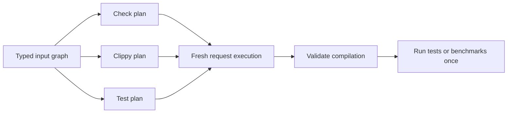

# Cargo workspace daemon

## Command contract

A single experimental Unix `cargo session` server now handles `check`, `build`,
`clippy`, `test`, and `bench`. It retains a separate prepared Cargo plan for each
command and argument list. Returning to a previous command reuses its plan while
its observed inputs remain valid.

```sh
export CARGO_SESSION_BIN=/absolute/path/to/this/checkout/target/release/cargo
export RUSTC="$(rustup which rustc)"
cd /path/to/workspace
"$CARGO_SESSION_BIN" session serve -p my-package
```

Use another shell with the same working directory and environment:

```sh
"$CARGO_SESSION_BIN" session check
"$CARGO_SESSION_BIN" session build --release
"$CARGO_SESSION_BIN" session clippy --all-targets -- -D warnings
"$CARGO_SESSION_BIN" session test
"$CARGO_SESSION_BIN" session test --test integration test_name -- --exact
"$CARGO_SESSION_BIN" session bench --no-run
"$CARGO_SESSION_BIN" session check --json
"$CARGO_SESSION_BIN" session status --json
"$CARGO_SESSION_BIN" session stop
```

The server's selection, features, profile, and configuration options are
**defaults**. Each request is parsed by the ordinary Cargo command schema.
Explicit request options replace the corresponding defaults. Selecting another
package or target replaces inherited target selection; selecting a profile
replaces inherited `--release` or `--profile`. Options that a command does not
support are not inherited. Global configuration from server startup is applied
before request configuration.

Place client `--socket PATH` and `--json` options before forwarded command
arguments. The ordinary Cargo `--` boundary is preserved, including through
aliases. Test filters and harness arguments are sent to Cargo's test runner;
Clippy arguments after `--` are sent to its driver. Unix argument bytes are
preserved; Clippy's driver argument encoding requires UTF-8, as cargo-clippy does.
Outer client global options are rejected: put request options after the command,
such as `cargo session check --config build.jobs=2`.

Launch environment and Cargo executable identity remain fixed. An environment
change requires restarting the session. Configuration-file and manifest changes
are detected by the input graph and retire affected plans. Status and stop may
address an explicit socket from a different directory or environment.

## State and invalidation

The retained values are complete prepared Cargo plans: fresh `GlobalContext`,
`Workspace`, command options, `UnitInterner`, and `BuildContext`. Each plan has
its own dependency read set in a shared, versioned `SessionInputs` graph. A new
plan observes the same input nodes without discarding other plans' read sets.
A changed node invalidates consumers of the old value; unrelated plans can stay
valid. Cargo-authored lockfile publication advances the writer's dependency and
invalidates other plans that consumed the previous value.



All borrowed Cargo objects are owned by safe, scoped `typed_arena::Arena`s,
ordered so that borrowers drop before owners. No lifetime is extended and no
context is leaked. A plan's interner is private: `PackageId` equality alone must
not intern packages from independently prepared manifest versions together.

`--max-plans COUNT` bounds the number of preparations in an arena generation
(default 16; range 1–256). Failed and retired preparations count toward the
limit because their allocations can remain in the arena. When another plan
would exceed the limit, the server releases the generation and lazily prepares
again. This bounds retained allocations by preparations, rather than by the
number of currently addressable plans. It is not an LRU or byte budget.

The plan key includes the command and exact argument list, including harness
arguments. Semantically equivalent spellings and different test filters can
therefore occupy separate plans. They do not share mutable compiler state.

Each compilation gets an ordinary fresh `BuildRunner`: jobs, mutable
fingerprints, build-script outputs, and build locks remain request scoped.
Compiler workers retain their existing eligibility rules and are used only for
eligible checks. Clippy, linking, tests, build scripts, and procedural macros
use their normal compiler paths. Opaque wrappers disable retained preparation;
the verified Clippy driver is admitted separately. All commands use Cargo's
ordinary per-unit freshness checks.

This is retained workspace planning with shared invalidation. Manifest parsing,
resolution, and unit-graph construction are still one cached computation per
command; an invalidated plan is rebuilt completely. Scheduling still traverses
the selected units and uses Cargo's ordinary freshness decisions. Fine-grained
semantic planning and scheduling only affected units remain separate work.

## Registry and Git sources

Warm sparse registries, local registries, and resolved Git dependencies can now
retain preparation. Observations are recorded where the source implementation
actually consumes them:

- Sparse cached index entries and registry configuration bytes.
- Local registry index bytes.
- Archive access and length, extracted-package completion markers, manifests,
  and target discovery.
- Resolved Git object and checkout revisions, working-directory selection,
  short object IDs, manifests, and package discovery.

Removing or changing one of those inputs invalidates its consumers. Cold
network updates, extraction, and checkout operations require fresh preparation;
a later request can retain the warmed source state. Git-backed registry indexes
and directory/vendored sources continue to prepare afresh because their full
input contracts are not covered. The policy is attached to the actual source,
including source replacements.

Source usage recorded during preparation is refreshed before automatic cache
GC at Cargo's existing timestamp resolution. Only descriptors recorded by
actual source use are retained; discovering a cache entry while scanning GC
state does not pin it. The normal scoped cache lock protects timestamp writes.
A plan whose unused source was removed must validate and prepare again.

## Clippy

The server uses Cargo's normal check planning with a request-local
`RUSTC_WORKSPACE_WRAPPER`, `CLIPPY_ARGS`, and noninteractive terminal width.
It resolves the Clippy driver alongside the selected compiler and verifies its
compiler identity before allowing reuse. Arbitrary wrappers retain the existing
fresh-preparation policy. Environment overlays do not mutate the process-wide
environment or leak into other command plans. Clippy arguments also participate
in fingerprints and build-script environment observations.

`--fix` follows ordinary Cargo fix execution. It may edit source files and does
not cache a prepared plan. It executes at most once after input validation; a
client disconnected before execution does not trigger fixes. Subsequent
commands validate their own plans against any changed inputs.

## Test and benchmark execution

Cargo's ordinary test and benchmark option parsers and post-compilation runners
are reused by the daemon and the ordinary commands. This preserves unit tests,
integration tests, doctests, `--no-run`, filters, harness arguments, target
runners, profiles, and failure exit codes. Every successful request executes its
selected tests even when compilation is entirely fresh.

Compilation results and preparation failures are validated before publication.
A planning input change can retry compilation, up to the existing three-attempt
limit, after discarding diagnostics from the obsolete attempt. Tests and
benchmarks start only after successful validated compilation. Once a harness
starts, its request is never retried. If it changes a planning input, its actual
result is returned and the plan is retired for the next request. Client
transport failures are never retried automatically.

## Protocol and diagnostics

Protocol v2 adds raw argument vectors and command selection. Old clients receive
a version error. Responses add `command`, `plan_id`, and `cached_plans`.
`preparations` counts all attempted preparations, and the existing `checks`
counter now counts all build-command requests. `reused` reports whether the
final attempt used an existing plan. `reprepare_reason` describes invalidation
or capacity rollover; `reuse_disabled_reason` describes unsupported input
contracts. Existing bounded output capture, serialized execution, socket
ownership, identity checks, and shutdown behavior are retained.

## Validation and measurements

The regression suite covers independent command plans, capacity rollover,
registry and Git invalidation, compiler and configuration changes, repeated
harness execution, compile and runtime failures, doctests, feature/profile/target
selection, aliases, Clippy configuration and lint arguments, build scripts,
procedural macros, and test programs that mutate manifests.

The reproducible mixed-command benchmark is
[benches/session_workspace.py](benches/session_workspace.py). It snapshots an
exact workspace revision, isolates build outputs, alternates execution order,
verifies recompilation and test execution, and records every sample and plan
counter. Source-unchanged and source-edit phases are reported separately;
command switching may still require compilation in the former.
