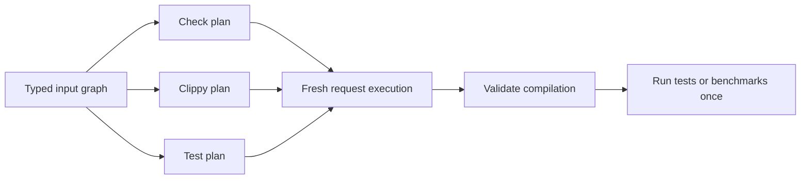

# Cargo workspace daemon

## Command contract

A single experimental Unix `cargo session` server now handles `check`, `build`,
`clippy`, `test`, and `bench`. It retains a separate prepared Cargo plan for each
command and argument list. Returning to a previous command reuses its plan while
its observed inputs remain valid.

```sh
export CARGO_SESSION_BIN=/absolute/path/to/this/checkout/target/release/cargo
export RUSTC="$(rustup which rustc)"
cd /path/to/workspace
"$CARGO_SESSION_BIN" session serve -p my-package
```

Use another shell with the same working directory and environment:

```sh
"$CARGO_SESSION_BIN" session check
"$CARGO_SESSION_BIN" session build --release
"$CARGO_SESSION_BIN" session clippy --all-targets -- -D warnings
"$CARGO_SESSION_BIN" session test
"$CARGO_SESSION_BIN" session test --test integration test_name -- --exact
"$CARGO_SESSION_BIN" session bench --no-run
"$CARGO_SESSION_BIN" session check --json
"$CARGO_SESSION_BIN" session status --json
"$CARGO_SESSION_BIN" session stop
```

The server's selection, features, profile, and configuration options are
**defaults**. Each request is parsed by the ordinary Cargo command schema.
Explicit request options replace the corresponding defaults. Selecting another
package or target replaces inherited target selection; selecting a profile
replaces inherited `--release` or `--profile`. Options that a command does not
support are not inherited. Global configuration from server startup is applied
before request configuration.

Place client `--socket PATH` and `--json` options before forwarded command
arguments. The ordinary Cargo `--` boundary is preserved, including through
aliases. Test filters and harness arguments are sent to Cargo's test runner;
Clippy arguments after `--` are sent to its driver. Unix argument bytes are
preserved; Clippy's driver argument encoding requires UTF-8, as cargo-clippy does.
Outer client global options are rejected: put request options after the command,
such as `cargo session check --config build.jobs=2`.

Launch environment and Cargo executable identity remain fixed. An environment
change requires restarting the session. Configuration-file and manifest changes
are detected by the input graph and retire affected plans. Status and stop may
address an explicit socket from a different directory or environment.

## State and invalidation

The retained values are complete prepared Cargo plans: fresh `GlobalContext`,
`Workspace`, command options, `UnitInterner`, and `BuildContext`. Each plan has
its own dependency read set in a shared, versioned `SessionInputs` graph. A new
plan observes the same input nodes without discarding other plans' read sets.
A changed node invalidates consumers of the old value; unrelated plans can stay
valid. Cargo-authored lockfile publication advances the writer's dependency and
invalidates other plans that consumed the previous value.



All borrowed Cargo objects are owned by safe, scoped `typed_arena::Arena`s,
ordered so that borrowers drop before owners. No lifetime is extended and no
context is leaked. A plan's interner is private: `PackageId` equality alone must
not intern packages from independently prepared manifest versions together.

`--max-plans COUNT` bounds the number of preparations in an arena generation
(default 16; range 1–256). Failed and retired preparations count toward the
limit because their allocations can remain in the arena. When another plan
would exceed the limit, the server releases the generation and lazily prepares
again. This bounds retained allocations by preparations, rather than by the
number of currently addressable plans. It is not an LRU or byte budget.

The plan key includes the command and exact argument list, including harness
arguments. Semantically equivalent spellings and different test filters can
therefore occupy separate plans. They do not share mutable compiler state.

Each compilation gets an ordinary fresh `BuildRunner`: jobs, mutable
fingerprints, build-script outputs, and build locks remain request scoped.
Compiler workers retain their existing eligibility rules and are used only for
eligible checks. Clippy, linking, tests, build scripts, and procedural macros
use their normal compiler paths. Opaque wrappers disable retained preparation;
the verified Clippy driver is admitted separately. All commands use Cargo's
ordinary per-unit freshness checks.

This is retained workspace planning with shared invalidation. Manifest parsing,
resolution, and unit-graph construction are still one cached computation per
command; an invalidated plan is rebuilt completely. Scheduling still traverses
the selected units and uses Cargo's ordinary freshness decisions. Fine-grained
semantic planning and scheduling only affected units remain separate work.

## Registry and Git sources

Warm sparse registries, local registries, and resolved Git dependencies can now
retain preparation. Observations are recorded where the source implementation
actually consumes them:

- Sparse cached index entries and registry configuration bytes.
- Local registry index bytes.
- Archive access and length, extracted-package completion markers, manifests,
  and target discovery.
- Resolved Git object and checkout revisions, working-directory selection,
  short object IDs, manifests, and package discovery.

Removing or changing one of those inputs invalidates its consumers. Cold
network updates, extraction, and checkout operations require fresh preparation;
a later request can retain the warmed source state. Git-backed registry indexes
and directory/vendored sources continue to prepare afresh because their full
input contracts are not covered. The policy is attached to the actual source,
including source replacements.

Source usage recorded during preparation is refreshed before automatic cache
GC at Cargo's existing timestamp resolution. Only descriptors recorded by
actual source use are retained; discovering a cache entry while scanning GC
state does not pin it. The normal scoped cache lock protects timestamp writes.
A plan whose unused source was removed must validate and prepare again.

## Clippy

The server uses Cargo's normal check planning with a request-local
`RUSTC_WORKSPACE_WRAPPER`, `CLIPPY_ARGS`, and noninteractive terminal width.
It resolves the Clippy driver alongside the selected compiler and verifies its
compiler identity before allowing reuse. Arbitrary wrappers retain the existing
fresh-preparation policy. Environment overlays do not mutate the process-wide
environment or leak into other command plans. Clippy arguments also participate
in fingerprints and build-script environment observations.

`--fix` follows ordinary Cargo fix execution. It may edit source files and does
not cache a prepared plan. It executes at most once after input validation; a
client disconnected before execution does not trigger fixes. Subsequent
commands validate their own plans against any changed inputs.

## Test and benchmark execution

Cargo's ordinary test and benchmark option parsers and post-compilation runners
are reused by the daemon and the ordinary commands. This preserves unit tests,
integration tests, doctests, `--no-run`, filters, harness arguments, target
runners, profiles, and failure exit codes. Every successful request executes its
selected tests even when compilation is entirely fresh.

Compilation results and preparation failures are validated before publication.
A planning input change can retry compilation, up to the existing three-attempt
limit, after discarding diagnostics from the obsolete attempt. Tests and
benchmarks start only after successful validated compilation. Once a harness
starts, its request is never retried. Its actual result is returned immediately.
If it changes a planning input, the next request invalidates the plan before
reusing it; no additional validation is needed after the harness finishes. Client
transport failures are never retried automatically.

## Protocol and diagnostics

Protocol v2 adds raw argument vectors and command selection. Old clients receive
a version error. Responses add `command`, `plan_id`, and `cached_plans`.
`preparations` counts all attempted preparations, and the existing `checks`
counter now counts all build-command requests. `reused` reports whether the
final attempt used an existing plan. `reprepare_reason` describes invalidation
or capacity rollover; `reuse_disabled_reason` describes unsupported input
contracts. Existing bounded output capture, serialized execution, socket
ownership, identity checks, and shutdown behavior are retained.

## Validation and measurements

The regression suite covers independent command plans, capacity rollover,
registry and Git invalidation, compiler and configuration changes, repeated
harness execution, compile and runtime failures, doctests, feature/profile/target
selection, aliases, Clippy configuration and lint arguments, build scripts,
procedural macros, and test programs that mutate manifests.

On 2026-09-06, local release validation passed 32 library tests, all 14 Cargo
CLI unit tests, and 57 selected integration tests (39 daemon cases and 18
existing report/GC cases). All 14 real compiler-worker tests also passed against
the workspace daemon, covering metadata reloads, compiler errors, output
isolation, locks, replacement, crash recovery, loader injection, and macro
fallback. Clippy lint and fix cases used an installed matching driver. All eight
[CI checks at `5454b21`](https://github.com/astral-sh/ohm-cargo/actions/runs/34038740726)
passed, including both Linux and macOS Cargo suites, explicit CLI unit tests,
and integration cases with Clippy installed.

### Workload and method

The four captures below select `cargo-platform` or `cargo-util-schemas` from
this repository's 27-member workspace, with stock Rust 1.98.0 or
`ohm-1.98.0-2`. They ran on 2026-09-06 on Linux x86_64, kernel
`6.8.0-106-generic`, glibc 2.39, with 32 CPUs in the process affinity mask.
[benches/session_workspace.py](benches/session_workspace.py) creates a separate
`git archive` snapshot at `c7fe941024f7245018d935254b46270bc28e8839` for each
capture; uncommitted checkout changes are excluded.

Each round runs `check`, `build`, `test`, and `clippy` in that order. There are
two warmup rounds, then 30 rounds with unchanged source and 30 rounds that
change one function body before running the sequence. The harness appends a
public function returning the round number to the selected package's `src/lib.rs`.
Each ordinary/daemon pair uses the same frozen Cargo binary, compiler, matching
rustdoc and Clippy, and command arguments (`--offline --locked
--message-format=json`). Each mode has separate target and build directories.
Ordinary/daemon execution order alternates per command; checks rotate through
three modes when the parent daemon is included. Compiler workers are disabled.

The tables report command wall-clock medians in milliseconds, including client
startup and the daemon round trip. Every cell is **ordinary → workspace daemon**.
The sequence column is the median of each round's sum of the four command times,
excluding the parent check. It is computed from raw rounds, rather than by adding
four independently computed medians.

Each capture retains 540 measured samples and 18 warmup samples: 2,160 measured
samples and 72 warmup samples in total. Startup and warmups are excluded from
summary statistics but remain recorded. No measured samples or outliers were
filtered. p95 uses the nearest-rank rule, `ceil(0.95 * n)` (the 29th sorted sample
when `n = 30`). A preliminary stock-toolchain attempt failed socket-directory
validation before collecting any samples; the harness now creates its work
directory with mode `0700`.

| Package / compiler | Source | Check | Build | Test | Clippy | Four-command sequence |
| --- | --- | ---: | ---: | ---: | ---: | ---: |
| cargo-platform / Rust 1.98.0 | Unchanged | 230.5 → 124.9 | 230.3 → 125.9 | 289.7 → 239.0 | 278.5 → 124.9 | 1,036.2 → 617.0 |
| cargo-platform / Rust 1.98.0 | Edited | 314.1 → 226.3 | 360.3 → 272.6 | 487.0 → 455.7 | 372.9 → 237.0 | 1,539.1 → 1,189.3 |
| cargo-platform / Ohm 1.98.0-2 | Unchanged | 242.1 → 138.0 | 241.0 → 138.0 | 306.4 → 266.1 | 288.5 → 138.0 | 1,078.2 → 678.5 |
| cargo-platform / Ohm 1.98.0-2 | Edited | 330.8 → 237.4 | 379.7 → 283.5 | 495.9 → 470.7 | 390.5 → 246.6 | 1,601.3 → 1,241.2 |
| cargo-util-schemas / Rust 1.98.0 | Unchanged | 264.8 → 154.5 | 261.0 → 153.4 | 899.4 → 862.7 | 308.1 → 151.4 | 1,739.4 → 1,315.4 |
| cargo-util-schemas / Rust 1.98.0 | Edited | 645.3 → 555.3 | 774.7 → 678.7 | 1,660.8 → 1,645.1 | 752.0 → 615.4 | 3,832.8 → 3,500.6 |
| cargo-util-schemas / Ohm 1.98.0-2 | Unchanged | 276.9 → 154.7 | 275.8 → 157.4 | 935.6 → 889.2 | 325.7 → 151.4 | 1,817.1 → 1,350.1 |
| cargo-util-schemas / Ohm 1.98.0-2 | Edited | 673.4 → 566.5 | 799.0 → 690.0 | 1,707.8 → 1,662.3 | 767.7 → 616.1 | 3,948.8 → 3,530.7 |

In these captures, the four-command sequence median decreases by 24.4–40.5% with
unchanged source and 8.7–22.7% after an edit. The unchanged phase happened to compile
zero selected-package artifacts in every sample; the harness still records
artifact freshness because switching commands can require compilation.
Every edited command recompiled at least one selected-package artifact.

All 960 measured workspace-daemon requests reused their command plan. Each
capture ended with four preparations, four cached plans, and 248 requests
(including eight warmup requests). Every measured test invocation ran eight
passing tests for `cargo-platform` or 13 for `cargo-util-schemas`; test execution
was preserved in both modes even when all artifacts were fresh.

### Test tail latency

Test medians improve modestly, and the stock `cargo-util-schemas` unchanged-source
p95 regresses from 947.4 to 1,105.1 ms (+16.7%). That sample distribution is kept
in full. The other seven test phase comparisons have lower daemon p95 values.
These are 30-sample captures; the raw reports include minima, maxima, and every
sample alongside the median and p95.

| Package / compiler | Unchanged test p95 | Edited test p95 |
| --- | ---: | ---: |
| cargo-platform / Rust 1.98.0 | 324.3 → 249.6 | 507.3 → 486.1 |
| cargo-platform / Ohm 1.98.0-2 | 315.2 → 273.5 | 513.5 → 490.4 |
| cargo-util-schemas / Rust 1.98.0 | 947.4 → 1,105.1 | 1,694.6 → 1,675.4 |
| cargo-util-schemas / Ohm 1.98.0-2 | 978.0 → 922.5 | 1,765.5 → 1,723.6 |

### Parent check comparison

The parent from [#113](https://github.com/astral-sh/ohm-cargo/pull/113) supports
only fixed `check` requests. Its registry sources have no session dependency
contract for these fixtures, so it performs fresh preparation on all 62 check
requests per capture, with zero measured plan reuse. The comparison below is
**parent daemon → workspace daemon**, in median milliseconds; it includes the
parent's documented fallback behavior.

| Package / compiler | Unchanged check | Edited check |
| --- | ---: | ---: |
| cargo-platform / Rust 1.98.0 | 207.9 → 124.9 | 307.5 → 226.3 |
| cargo-platform / Ohm 1.98.0-2 | 230.9 → 138.0 | 341.3 → 237.4 |
| cargo-util-schemas / Rust 1.98.0 | 243.7 → 154.5 | 644.1 → 555.3 |
| cargo-util-schemas / Ohm 1.98.0-2 | 267.6 → 154.7 | 677.2 → 566.5 |

### Captured identities and raw data

The measured Cargo executables were copied and frozen before the captures.
The results above are tied to these binaries and the harness hashes below.
The parent binary's Rust sources match #113 at
`c7fe941024f7245018d935254b46270bc28e8839`. Its version output reports the stale
embedded commit `bd069fee9e06751fa6b8b39af0e31691d39c5a7a`, retained by shared
Cargo build-script outputs as described in the
[worker measurements](tools/session-rustc/README.md). The SHA-256 below identifies
the actual parent executable; the workspace Cargo binary has a fresh embedded
identity matching its `89b6211` source revision.

Stock Rust is `1.98.0` at `88d9e12ae178fab0fb5cc050a94da85685d449ea`;
Ohm is `1.98.0-dev (ohm-1.98.0-2)` at
`e03456bd220c9c4b4b7d6f74d0a047cc708bc633`. Both use LLVM 22.1.8.
Each raw report also records the resolved compiler, rustdoc, cargo-clippy, and
Clippy-driver paths and hashes, compiler identity checks, Cargo configuration
hashes, environment digests and overrides, source hashes, lockfile hash, startup
state, final counters, commands, and log paths.

| Identity | Source revision or file | SHA-256 |
| --- | --- | --- |
| Cargo for ordinary commands and workspace daemon | `89b6211b43f18aa2519571a28bb81e395ef44b7e` | `640d60be282af5c21f0708a72d8ad8219910a7e31850d1216ed8aaadaa958565` |
| Parent #113 Cargo | Rust sources match `c7fe941024f7245018d935254b46270bc28e8839` | `89a0d387b8d7921cb7345f15695bdd526d2e04b1b0dcda7de5cd90d0147ab309` |
| Benchmark harness | `benches/session_workspace.py` | `dde8b8eae45143e7924b5f9c1403bc050599241d3708d8d2f99a3df39848138d` |
| Shared harness helper | `benches/session.py` | `4c503d5edba2a07988c472ba3839fc27d94c194949247ff859d07d3f6c394a06` |
| Fixture lockfile at `c7fe941024f7245018d935254b46270bc28e8839` | `Cargo.lock` | `e2a3de477681336c8966cb63859f4eb7d590acf6c90582eda23a4f43f35593ff` |

| Package / compiler | Raw report |
| --- | --- |
| cargo-platform / Rust 1.98.0 | [JSON](benches/session/results/workspace-platform-stock-1.98-linux-x86_64.json) |
| cargo-platform / Ohm 1.98.0-2 | [JSON](benches/session/results/workspace-platform-ohm-1.98.0-2-linux-x86_64.json) |
| cargo-util-schemas / Rust 1.98.0 | [JSON](benches/session/results/workspace-schemas-stock-1.98-linux-x86_64.json) |
| cargo-util-schemas / Ohm 1.98.0-2 | [JSON](benches/session/results/workspace-schemas-ohm-1.98.0-2-linux-x86_64.json) |

To reproduce all four workloads, supply the frozen Cargo executables above and
matching installed toolchains, then run the following from this checkout. The
harness creates and retains a new private work directory for each invocation,
preferring `/run/user/$(id -u)` when available. Each directory contains
`report.json`, `samples.jsonl`, the workspace snapshot, isolated build outputs,
and logs. Both Rust toolchains must include matching rustdoc and Clippy.

```sh
workspace_cargo=/absolute/path/to/frozen-workspace-cargo
parent_cargo=/absolute/path/to/frozen-parent-cargo
for toolchain in 1.98.0-x86_64-unknown-linux-gnu ohm-1.98.0-2; do
  for package in cargo-platform cargo-util-schemas; do
    python3 benches/session_workspace.py \
      --cargo "$workspace_cargo" \
      --parent-cargo "$parent_cargo" \
      --rustc "$HOME/.rustup/toolchains/$toolchain/bin/rustc" \
      --revision c7fe941024f7245018d935254b46270bc28e8839 \
      --package "$package" \
      --source "crates/$package/src/lib.rs" \
      --rounds 30 --warmup-rounds 2 --require-reuse
  done
done
```

## Test validation follow-up

After test or benchmark execution, the server previously validated the whole
input graph a third time. Compilation had already validated its planning inputs
before and after the build, and the last pass only decided whether to retain the
plan for a future request. The follow-up removes that last pass and returns the
actual harness result immediately. Tests and benchmarks still execute at most
once per request. Every future plan use validates inputs before compilation, so
manifest changes made by a harness invalidate the plan before it can be reused.
A plan can remain included in `cached_plans` until that validation occurs;
retirement through `!prepared.can_reuse()` remains active.

### Focused test workload

This study repeats only `test`, using `baseline_session` in the same capture
to compare #116 with the follow-up. All three modes are interleaved in the same
capture with rotating order: ordinary Cargo, the #116 workspace daemon, and the
updated daemon. Ordinary Cargo uses the updated binary. Each mode has a separate
target/build directory and the same pinned compiler and matching rustdoc. The
benchmark uses `--offline --locked --message-format=json` and no compiler worker.
The earlier mixed-command study has different artifact state and execution
order, so its absolute timings are not comparable to this test-only study.

Each capture has two warmup rounds, 30 rounds with unchanged source, and 30
rounds changing the appended function body in the selected package. The fixture
is archived at `c7fe941024f7245018d935254b46270bc28e8839`. Every measured mode has
30 samples per phase. Wall-clock timings include client startup and the daemon
round trip; p95 is nearest rank over all 30 samples. Warmups remain in the raw
report but are excluded from summary statistics. No outliers are filtered.

The four captures were recorded on 2026-09-06 on Linux x86_64. All times below
are milliseconds.

| Package / compiler | Source | Ordinary median / p95 | #116 daemon median / p95 | Updated daemon median / p95 | Median reduction vs #116 |
| --- | --- | ---: | ---: | ---: | ---: |
| cargo-platform / Rust 1.98.0 | Unchanged | 286.9 / 303.4 | 209.5 / 219.8 | 158.2 / 163.8 | 24.5% |
| cargo-platform / Rust 1.98.0 | Edited | 606.7 / 640.2 | 539.4 / 553.7 | 490.6 / 504.1 | 9.0% |
| cargo-platform / Ohm 1.98.0-2 | Unchanged | 301.9 / 310.5 | 208.7 / 216.4 | 163.1 / 170.2 | 21.8% |
| cargo-platform / Ohm 1.98.0-2 | Edited | 615.3 / 631.0 | 541.8 / 556.1 | 498.6 / 514.0 | 8.0% |
| cargo-util-schemas / Rust 1.98.0 | Unchanged | 909.6 / 954.9 | 811.4 / 831.7 | 759.5 / 797.2 | 6.4% |
| cargo-util-schemas / Rust 1.98.0 | Edited | 1,688.2 / 1,721.6 | 1,599.0 / 1,650.5 | 1,547.0 / 1,581.5 | 3.2% |
| cargo-util-schemas / Ohm 1.98.0-2 | Unchanged | 933.3 / 979.2 | 824.6 / 839.4 | 774.9 / 796.6 | 6.0% |
| cargo-util-schemas / Ohm 1.98.0-2 | Edited | 1,684.6 / 1,732.5 | 1,598.7 / 1,646.0 | 1,542.6 / 1,575.4 | 3.5% |

Each capture retains 180 measured samples and six warmups, for **720 measured
samples and 24 warmup samples** across the four captures. Both daemons reuse one
plan on all 60 measured requests per capture: **480/480 combined daemon
requests reuse their plan**. Each daemon finishes with one preparation, one
cached plan, and 62 requests including warmups.

Every unchanged-source sample compiles zero selected-package artifacts. Edited
samples recompile four for `cargo-platform` or two for `cargo-util-schemas`.
Each test invocation reports eight passing tests for `cargo-platform` or 13
for `cargo-util-schemas`. The harness requires plan reuse from both daemons,
recompilation after edits, and successful nonempty test execution; raw artifact
and test-result records support these checks.

All eight median and p95 comparisons improve against the baseline measured in
the same capture. Median savings are 45.6–51.9 ms with unchanged source and
43.3–56.1 ms after an edit. Every sample remains included in the reported
statistics.

### Follow-up identities and reproduction

The updated binary was frozen at source and embedded commit
`790153923caf1bdbe62d22ff17c01775c04d7513`. Later harness changes and the merge
from #116 leave that compiled Cargo implementation unchanged. The baseline is
the frozen `89b6211b43f18aa2519571a28bb81e395ef44b7e` binary, whose compiled
Cargo Rust sources match #116 at `c3ef330cf5a310fd689ebe614c984d06cf3518b7`.
The harness at `32c05ae4b37eceabb9adef068549f4ec86424508` adds a full workspace
daemon baseline and requires reuse from both daemon modes.

| Identity | Source revision or file | SHA-256 |
| --- | --- | --- |
| Updated Cargo | `790153923caf1bdbe62d22ff17c01775c04d7513` | `c2513aa538d8e75a93c42c4ce98bf01a90a9346bbd73fe0fb8615fc31011dc59` |
| Baseline #116 Cargo | `89b6211b43f18aa2519571a28bb81e395ef44b7e` | `640d60be282af5c21f0708a72d8ad8219910a7e31850d1216ed8aaadaa958565` |
| Focused-study harness | `benches/session_workspace.py` at `32c05ae` | `5f19e883d8a685336f9e3545583c7d4f6a756e1f6a84d118ee44f18549c06741` |
| Shared harness helper | `benches/session.py` | `4c503d5edba2a07988c472ba3839fc27d94c194949247ff859d07d3f6c394a06` |

| Package / compiler | Raw report |
| --- | --- |
| cargo-platform / Rust 1.98.0 | [JSON](benches/session/results/workspace-test-validation-platform-stock-1.98-linux-x86_64.json) |
| cargo-platform / Ohm 1.98.0-2 | [JSON](benches/session/results/workspace-test-validation-platform-ohm-1.98.0-2-linux-x86_64.json) |
| cargo-util-schemas / Rust 1.98.0 | [JSON](benches/session/results/workspace-test-validation-schemas-stock-1.98-linux-x86_64.json) |
| cargo-util-schemas / Ohm 1.98.0-2 | [JSON](benches/session/results/workspace-test-validation-schemas-ohm-1.98.0-2-linux-x86_64.json) |

Use the recorded frozen executables and matching Rust/rustdoc toolchains to
reproduce all four package/compiler combinations. The harness retains each new
private work directory with `report.json`, `samples.jsonl`, source snapshots,
build outputs, and logs.

```sh
updated_cargo=/absolute/path/to/frozen-test-validation-cargo
baseline_cargo=/absolute/path/to/frozen-workspace-cargo
for toolchain in 1.98.0-x86_64-unknown-linux-gnu ohm-1.98.0-2; do
  for package in cargo-platform cargo-util-schemas; do
    python3 benches/session_workspace.py \
      --cargo "$updated_cargo" \
      --baseline-cargo "$baseline_cargo" \
      --rustc "$HOME/.rustup/toolchains/$toolchain/bin/rustc" \
      --revision c7fe941024f7245018d935254b46270bc28e8839 \
      --package "$package" --source "crates/$package/src/lib.rs" \
      --commands test --rounds 30 --warmup-rounds 2 --require-reuse
  done
done
```

All 11 command integration tests passed locally, including the strengthened
manifest-mutation case: two requests execute twice, the second request prepares
a new plan, and its invalidation reason names `Cargo.toml`. The pull request
records the full CI results.
